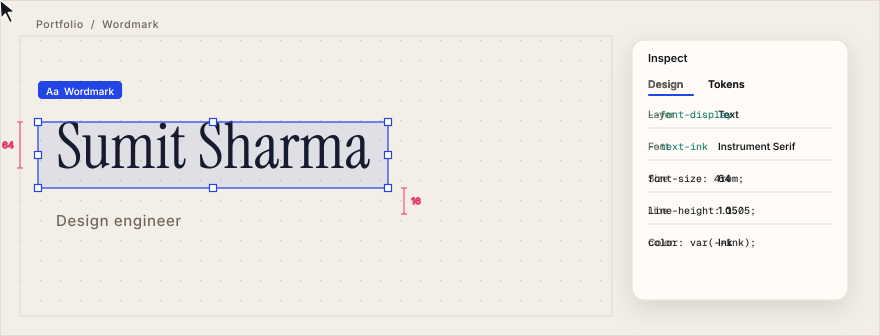

  <picture>
    <source media="(prefers-color-scheme: dark)" srcset="assets/header-dark.svg">
    
  </picture>

I build products for the web, from the first interface to the details of how it works. I shipped [Glyph](https://glyph.software), a brand-identity tool, and I make tools for people who build interfaces: Glaze, Glyph-Skill, and Slate.

## Work

**[Glyph](https://glyph.software):** Describe your idea and get a logo, colours, typography, and brand assets, then take the identity into your AI builder.

**[Glyph-Skill](https://github.com/sumitttt4/Glyph-Skill):** An open-source design skill for coding assistants. It helps them understand the product, choose a direction, build the interface, and check what actually rendered.

**[Glaze](https://glazeui.xyz):** Open-source React components for interfaces, AI, and voice, each in four finishes. Install any component with one shadcn command. ([GitHub](https://github.com/sumitttt4/Glazeui))

**[Slate](https://sumitsharma.pro/projects/slate):** A library of crafted launch films you can make yours. Swap in your brand and the film preview updates live.

**[Fedup Studio](https://fedup.studio):** A free library of complete landing pages taken from real open-source products. Preview a page, take the code, make it yours.

## Stack

TypeScript, React, and Next.js, styled with Tailwind, designed in Figma. Node.js, Supabase, PostgreSQL, Clerk, and Stripe when a product needs to ship.

## Contact

[sumitsharma.pro](https://sumitsharma.pro) · [X](https://x.com/sumitdotme) · [LinkedIn](https://www.linkedin.com/in/sumitsharma4) · [Email](mailto:sumitsharma9128@gmail.com)
